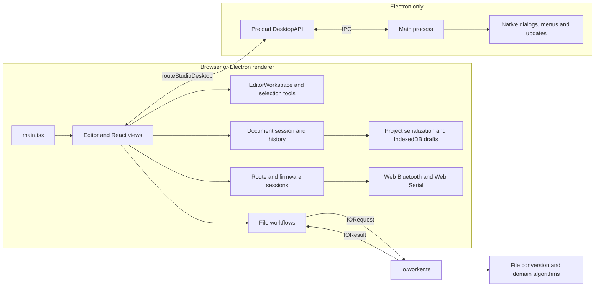

# Architecture

[Documentation](README.md) · [Project overview](../README.md)

Route Studio uses one React editor in a browser and in an Electron renderer. Vite builds the static editor; Electron adds native dialogs, menus, Bluetooth and serial port selection, and software updates. Route parsing and editing run locally. Network clients access map, terrain, magnetic declination and release services directly; this repository has no application backend.

This guide describes the current source layout and dependencies. See [development](development.md) for commands, [file formats](formats.md) for compatibility, and [releasing](releasing.md) for distribution.

## Repository map

| Location                                                                  | Current responsibility                                                                                                     |
| ------------------------------------------------------------------------- | -------------------------------------------------------------------------------------------------------------------------- |
| [src/main.tsx](../src/main.tsx)                                           | Initializes appearance, loads a recovery draft and mounts the editor.                                                      |
| [src/app/](../src/app/)                                                   | Application composition, shared layout styles and coordination between editor, export, settings and device workflows.      |
| [src/features/](../src/features/)                                         | Editing, elevation, declination, resampling, export, device and settings UI, with their workflow hooks and feature styles. |
| [src/ui/](../src/ui/)                                                     | Shared controls, dialogs and theme behavior.                                                                               |
| [src/platform/](../src/platform/)                                         | Browser/native file saving and IndexedDB draft storage.                                                                    |
| [src/services/](../src/services/)                                         | Magnetic lookup and Copernicus terrain sampling/network clients.                                                           |
| [src/workers/](../src/workers/)                                           | Typed IO messages, Worker lifecycle and background request handling.                                                       |
| [src/views/](../src/views/)                                               | Interactive map, elevation profiles, station symbols and basemap controls.                                                 |
| [src/domain/](../src/domain/)                                             | Route model, geometry edits, station projection, elevation repair, resampling, terrain planning and declination rules.     |
| [src/files/](../src/files/)                                               | FIT/GPX/KML conversion and project serialization.                                                                          |
| [src/rte/](../src/rte/)                                                   | RTE binary/CBOR encoding, validation, metadata, export processing and conversion to/from the route model.                  |
| [src/device/](../src/device/)                                             | Web Bluetooth and Web Serial transports, MCUmgr clients, route transfers, firmware parsing and upgrade sessions.           |
| [src/maps/](../src/maps/)                                                 | Basemap provider configuration, style construction and locally stored map preferences.                                     |
| [src/i18n/](../src/i18n/)                                                 | English and Simplified Chinese strings, language selection and shared localized text types.                                |
| [electron/](../electron/)                                                 | Main process, preload bridge, desktop contracts, command definitions, security and update services.                        |
| [tests/](../tests/)                                                       | Unit tests, protocol fixtures, browser workflows, desktop workflows and CI policy checks.                                  |
| [scripts/](../scripts/)                                                   | Desktop development/build orchestration, CI selection, icon generation and release verification.                           |
| [build/](../build/), [public/](../public/), [src/assets/](../src/assets/) | Packaging resources and entitlements, public assets and renderer assets.                                                   |

`build/` contains packaging inputs. Generated outputs are `dist/` for the editor, `dist-electron/` for compiled Electron code, and `release/` for packaged applications and installers. They are ignored by Git.

## Runtime boundaries

The diagram shows runtime communication, not all module imports. The browser has no desktop bridge; the renderer detects `window.routeStudioDesktop` where native behavior is needed.

### Renderer and Worker

[Editor.tsx](../src/app/Editor.tsx) composes the feature workflows, commands and modal interlocks. It coordinates route replacement, export settings, elevation tools and device/update state. [EditorWorkspace.tsx](../src/features/editor/EditorWorkspace.tsx) renders the outline, map, profile and inspector. [MapView](../src/views/MapView.tsx) and [ProfileView](../src/views/ProfileView.tsx) display the document and send interactions back through callbacks.

[contracts.ts](../src/workers/contracts.ts) defines the `IORequest` and `IOResult` unions; [io.ts](../src/workers/io.ts) provides the `runIO` client. Each call creates a module Worker from [io.worker.ts](../src/workers/io.worker.ts). The Worker handles import, track export, RTE compilation, terrain sampling and resampling. It returns serializable results, including error codes or targets used by the UI. Binary export buffers are transferred back to the renderer. A result or Worker error terminates the Worker; an abort terminates it and rejects the request with `AbortError`.

Project saving and draft persistence run in the renderer. Magnetic lookup is also initiated there through [useDeclinationLookup.ts](../src/features/declination/useDeclinationLookup.ts) and [declination.ts](../src/services/declination.ts). Keep DOM-dependent work outside the Worker.

### Editor workflow ownership

| Module                                                             | Owns                                                                                  | Integration boundary                                                                                                    |
| ------------------------------------------------------------------ | ------------------------------------------------------------------------------------- | ----------------------------------------------------------------------------------------------------------------------- |
| [useDocumentSession](../src/features/editor/useDocumentSession.ts) | Document history, saved baseline, draft persistence and source/session identity.      | Edits and replacements change the document; a successful project save marks a specific snapshot saved.                  |
| [useRouteFiles](../src/features/editor/useRouteFiles.ts)           | Import/track choices, pending replacement, import/save locks and file errors.         | Calls the Worker and platform saver; reports accepted replacements, notices and successful project saves to its caller. |
| [useEditorSelection](../src/features/editor/useEditorSelection.ts) | Selection, editing tool, focus/hover, map commands and geometry interaction handlers. | Produces document edits through a callback; reconciles selection when history changes.                                  |
| [EditorWorkspace](../src/features/editor/EditorWorkspace.tsx)      | Outline, map, profile and inspector layout.                                           | Receives the document, selection controls and feature callbacks.                                                        |
| [FileDialogs](../src/features/editor/FileDialogs.tsx)              | Processing, route-choice and replacement-confirmation UI.                             | Presents the file workflow state; cancellation leaves the active document and history intact.                           |

The shared save lock covers both project and export writes. Native cancellation leaves the current document dirty; an export does not mark it saved. Route replacement resets history and the feature state coordinated by `Editor`. View switches between export and device management retain the shared device session.

### Electron bridge

[contracts.ts](../electron/contracts.ts) defines `DesktopAPI`; [desktop.d.ts](../src/desktop.d.ts) adds its optional renderer global. [preload.cts](../electron/preload.cts) exposes the API through `contextBridge`. It maps methods and subscriptions to specific IPC channels rather than exposing the Node filesystem or arbitrary IPC access.

[main.cts](../electron/main.cts) owns the application window, native file dialogs, menu, Bluetooth selection/pairing, serial port selection and update integration. Shared command IDs and shortcuts live in [electron/commands.ts](../electron/commands.ts); [src/features/editor/commands.ts](../src/features/editor/commands.ts) re-exports them for the editor. The renderer reports command availability and document dirty/busy state, which the main process uses for menus, closing and update installation.

The renderer uses context isolation, sandboxing, disabled Node integration and a restricted `app://route-studio/` protocol with CSP. Only the main frame can use the file bridge, and it cannot supply filesystem paths. HTTP/HTTPS links open in the system browser.

[security.ts](../electron/security.ts) contains URL, resource-path and filename checks. The main process checks the sender and arguments for desktop requests and chooses filesystem paths through native dialogs. Update state and platform decisions are separated into [update-service.ts](../electron/update-service.ts), [update-release.ts](../electron/update-release.ts) and [updates.cts](../electron/updates.cts).

Native imports validate the selected file's extension, regular-file status and 64 MiB size limit. Existing filenames may contain any characters supported by the host filesystem. Portable filename restrictions and the 180-character limit apply only to save-name suggestions supplied by the renderer.

## Route document model

[RouteDocument](../src/domain/model.ts) is the editable model shared by views, domain operations, importers and exporters:

- `vertices` is the ordered route geometry. Each vertex has an ID and latitude/longitude.
- An `Anchor` identifies an outgoing segment by its starting `vertexId` and a `fraction` along that segment. The final endpoint uses the last vertex with fraction zero. An anchor identifies a particular visit even when the route crosses itself or repeats coordinates.
- `elevation` stores samples at anchors independently of the geometry vertices. A `null` height preserves a missing measurement.
- `stations` stores names, kinds, stage-boundary flags and optional short labels. A station can have an anchor, a separate landmark `location`, or an unassigned anchor. Route distance and landmark coordinates can therefore be edited independently.
- `elevationReference` records the height reference. Optional `rte` context preserves imported format-specific information, including distance/index information and magnetic metadata. Optional `declination` stores automatic, manual or omitted magnetic settings.

[model.ts](../src/domain/model.ts) provides distance and anchor calculations; [edit.ts](../src/domain/edit.ts) and [projection.ts](../src/domain/projection.ts) handle geometry changes and station placement. Keep point identity, valid anchor references and missing-height behavior intact when changing these operations.

[project.ts](../src/files/project.ts) serializes a `.routeproj` as a JSON envelope with `format: "route-studio"`, `version: 1` and `document`. Validation permits empty routes, missing heights and incomplete stations while requiring consistent IDs and anchors. Export formats impose their own constraints; a valid editable project does not necessarily have a valid RTE export.

## Document lifecycle

### Import and replacement

1. A browser file input, drop event or desktop file dialog supplies a `File` to the editor. Desktop reads cross the bridge as a filename and bytes.
2. `runIO({ type: 'read', ... })` dispatches by extension to the project loader, RTE reader, FIT parser or GPX/KML parser.
3. Multiple routes or unconfirmed heights return `choices`. The editor obtains a selection/confirmation and submits the file again with those choices.
4. The Worker returns a `RouteDocument` and, when assessment succeeds, an elevation assessment. The editor requests confirmation before replacing a document with unsaved edits.
5. Replacement clears undo/redo history, resets transient editing/export state and establishes the loaded document as the save-state baseline.

### Editing and recovery

[useDocumentSession.ts](../src/features/editor/useDocumentSession.ts) owns history, the saved baseline, draft status, source filename and replacement session number. Its [history.ts](../src/features/editor/history.ts) reducer uses `past`, `doc` and `future` snapshots. Ordinary edits replace the document, retain up to 60 previous snapshots and clear redo. Undo/redo selects earlier or later snapshots; document replacement resets the history. Automatic declination lookup updates only the matching current settings/reference and does not create an ordinary edit-history entry.

The document session compares the current document object with its saved baseline to determine unsaved changes. Saving a project updates that baseline only after a successful save. Exporting a route does not mark the project saved.

[draft.ts](../src/platform/storage/draft.ts) stores the serialized current project in IndexedDB (`route-studio`, store `drafts`, key `current`). It resolves writes after transaction completion. Once autosave is active, the document session saves document changes and reports failures. Startup attempts draft recovery before mounting the editor; a recovery failure opens an empty editor with an error state. Drafts preserve the document, not undo history, active dialogs or device upload recovery state.

### Preview and export

[ExportDialog.tsx](../src/features/export/ExportDialog.tsx) requests a preview and output bytes for the current document, format and options. It aborts obsolete jobs and checks that a result still matches the current inputs before presenting it. File export presents format, filename and download controls. The separate **Send current route** command reuses the same preview and settings in RTE-only mode with a device send action. Starting a send retains the document and processing settings for that transfer, so reopening a pending task preserves its preview while the editor remains usable.

RTE export calls `prepareRte` in [src/rte/index.ts](../src/rte/index.ts), with processing options from [processing.ts](../src/rte/processing.ts). GPX/KML/FIT export calls `exportTrack` in [src/files/export.ts](../src/files/export.ts). These operations derive output from the document; export resampling, simplification and smoothing do not rewrite the project. The separate route resampling tool applies its result as an undoable edit.

[platform/files.ts](../src/platform/files.ts) uses the native save bridge on desktop and a Blob download in the browser. The send preview passes validated RTE bytes to the device session for upload.

## External services and local state

Map rendering and styles are handled by [MapView.tsx](../src/views/MapView.tsx) and [basemap.ts](../src/maps/basemap.ts). Terrain planning lives in `src/domain/`; sampling and online tile access live in [copernicus.ts](../src/services/terrain/copernicus.ts) and [copernicus-online.ts](../src/services/terrain/copernicus-online.ts). Magnetic HTTP lookup lives in `src/services/declination.ts`.

[useDevices.ts](../src/features/device/useDevices.ts) creates the route and firmware sessions around one [BluetoothSession](../src/device/bluetooth-session.ts), which owns the physical connection and reserves it for active transfers. [DeviceSession](../src/device/session.ts) is shared by the send preview and device route manager. [mcumgr.ts](../src/device/mcumgr.ts) owns Web Bluetooth/SMP transport, [routes.ts](../src/device/routes.ts) implements route catalog operations, and [upload.ts](../src/device/upload.ts) transfers bytes before device validation and catalog publication. Pending bytes and transaction state stay in memory across views and reconnects; they are not persisted across app restarts. The editor exposes device actions in a submenu and shows active or interrupted tasks in the status bar.

[firmware.ts](../src/device/firmware.ts) validates local MCUboot containers and SHA-256 digests and implements standard Image Group 1 and OS reset commands. The upload-session digest covers the complete file; image state requests identify the image by its MCUboot digest. Signature verification and image acceptance remain the bootloader's responsibility. [FirmwareSession](../src/device/firmware-session.ts) coordinates file selection, resumable upload, test/restart, reconnection, confirmation and recovery state independently of route catalog commands. Route and firmware sessions reuse the shared Bluetooth connection; switching or closing panels does not disconnect it. Connecting alone does not query the route catalog.

[serial.ts](../src/device/serial.ts) carries SMP over Web Serial using console framing: length and CRC16-XMODEM, Base64 lines, and start/continuation markers. It serializes requests and validates response headers and CRCs. USB recovery uploads directly through the bootloader and offers reset without requiring image state, test or confirmation support. [FirmwareDialog](../src/features/device/FirmwareDialog.tsx) opens in a fixed Bluetooth update or USB recovery mode according to its menu entry; [DesktopSerial](../src/features/device/DesktopSerial.tsx) presents the Electron serial chooser through the narrow preload bridge. USB recovery uses its own connection. Active firmware operations participate in editor and desktop-update interlocks. File bytes and progress are retained only in memory.

Language, appearance and map preferences use local storage separately from project data. Desktop draft/preference storage belongs to the Electron profile. Update preferences are stored by the main process in `updates.json` under Electron's user-data directory. See the [user guide](user-guide.md#online-services-and-device-upload) for network data exposure, credentials and device requirements.

## Current dependencies and extension points

Feature views and hooks depend on the domain model and use `workers/`, `services/` and `platform/` for IO. Shared `ui/` controls and `i18n/` do not depend on application composition. `files/` handles codecs and project serialization; draft storage in `platform/` uses that serialization. Service clients have no React dependency, and the Worker handler imports its message contracts independently of the renderer client.

The domain and RTE modules retain their existing coupling: `src/domain/model.ts` imports RTE context types, terrain/declination operations reuse RTE validation and messages, and RTE conversion imports domain operations. Renderer code also imports desktop contracts and runtime-independent command definitions from `electron/`. These are current dependencies, not independent packages.

For new work, keep route calculations independent of React and Electron runtime APIs, put protocol-specific checks beside their codecs, and use the existing Worker or desktop bridge when crossing runtime boundaries. Reuse the existing module that owns a responsibility. Any future extraction should preserve these contracts and update this guide when the implementation changes.

| Change                                   | Start here                                                                                                    | Verification                                                                |
| ---------------------------------------- | ------------------------------------------------------------------------------------------------------------- | --------------------------------------------------------------------------- |
| Geometry, stations or elevation behavior | `src/domain/`, then the relevant editor/view callbacks                                                        | `tests/domain/` and the affected `tests/e2e/` workflows                     |
| Import/export format                     | `src/files/` or `src/rte/`, Worker requests, export/import UI; desktop extension checks for a new file suffix | Format fixtures, round trips/limits and browser/desktop file workflows      |
| Map provider or terrain source           | `src/maps/basemap.ts`, map settings/view, or Copernicus sampling and domain terrain planning                  | `tests/maps/`, `tests/services/`, terrain domain tests and browser previews |
| Device operation                         | `src/device/`, `useDeviceRoutes`, device/upload UI; desktop pairing if needed                                 | `tests/device/`, upload workflows and physical devices                      |
| Desktop capability or editor command     | Contracts, preload, main process, command definitions and renderer caller                                     | Desktop unit tests and `tests/desktop/app.spec.ts`                          |

See [test locations](development.md#test-locations) for how those suites run. If source paths change later, also check [ci-policy.mjs](../scripts/ci-policy.mjs), Worker URLs, [Electron compilation](../electron/tsconfig.json), and [packaged resource paths](../electron-builder.yml), including desktop translation files. CI selection depends on paths and names, so moving a file can change the validation it receives.
